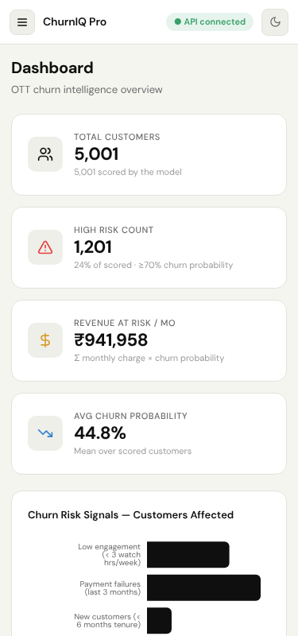
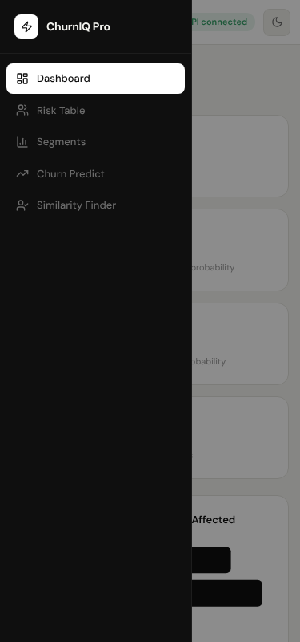
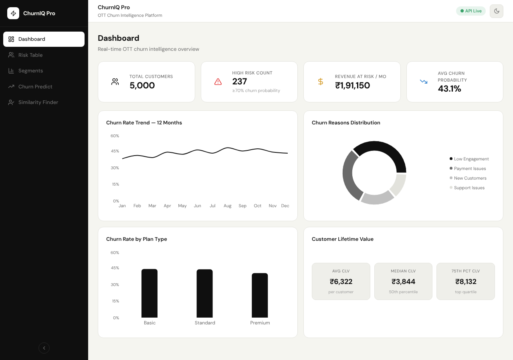
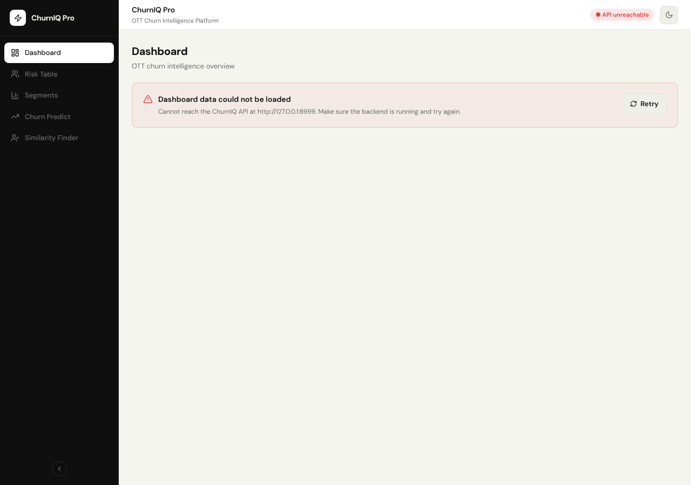
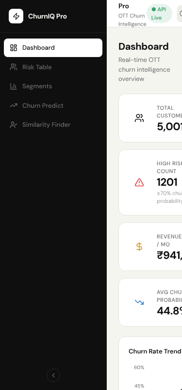

# CHURN-IQ — Frontend UI Test Report (E5: CHURN-26 to CHURN-31)

Test evidence for the E5 frontend stories assigned to Avanish Rajauria. Results were measured automatically, not judged by eye:

* page text was read in a real browser and compared in code with the JSON the API returned;
* layout overflow was measured with `scrollWidth > clientWidth`.

The work was carried out with AI-assisted development tools.

## Environment

| Item | Value |
|---|---|
| Base commit (before) | `main` @ `e95b65b` |
| Branch (after) | `feature/avanish-e5-e6-completion` |
| Backend | local `uvicorn main:app` on 127.0.0.1:8000, Python 3.13.18; `GEMINI_API_KEY` and `EMAIL_API_TOKEN` unset |
| Frontend | production build (`vite build`) served by `vite preview`; Node 22.23.5 |
| Browser | Chromium via Playwright 1.65.1 |
| Backend stopped | simulated by building with `VITE_API_URL=http://127.0.0.1:8999`, where nothing listens |

**Not exercised:**

* **Production fallback:** every request to the production host `*.onrender.com` was blocked during testing, so the old production-fallback path was never exercised.
* **Email sending:** `/send-email` was blocked and asserted not to be called. **0 emails** were attempted.
* **Live Gemini:** with no key, `/retention` returned its rule-based fallback, which the UI now labels as such.

## 1. Automated tests

| Suite | Command | Result |
|---|---|---|
| Frontend unit and component tests (new) | `cd frontend && npm test` | **70 passed**, 7 files |
| Frontend build | `cd frontend && npm run build` | builds; only the pre-existing chunk-size warning |
| Backend (unchanged by this work) | `cd backend && python -m pytest -q` | **481 passed** (see the PR) |

**Mutation checks.** Selected fixes were reverted on purpose to confirm the tests catch them:

* **Alphabetical risk sorting** was restored. The severity-sort test failed. ✅
* **The ignore-stale-responses guard** was removed from `useApi`. The slow-response test failed. ✅
* **The `key` on the per-customer view** was removed. No test failed, because the loading screen shown during every customer change already unmounts the old view. The `key` is defence in depth.

## 2. CHURN-26 — Dashboard KPIs vs API

| KPI / value | API | UI | Result |
|---|---|---|---|
| Total customers | 5,001 | 5,001 | ✅ Pass |
| High risk count | 1,201 | 1,201 | ✅ Pass |
| Revenue at risk / mo | ₹941,958 | ₹941,958 | ✅ Pass |
| Avg churn probability | 44.8% | 44.8% | ✅ Pass |
| Avg CLV (by_plan weighted) | ₹6,089 | ₹6,089 | ✅ Pass |
| High CLV tier count | 1,232 | 1,232 | ✅ Pass |
| Low CLV tier count | 2,264 | 2,264 | ✅ Pass |
| Medium CLV tier count | 1,505 | 1,505 | ✅ Pass |
| High-risk % sub-label | 24% of scored | 24% of scored · ≥70% churn probability | ✅ Pass |
| Priority row churn % / risk | 71.7% / HIGH | CUST02261 71.7% Premium ₹11,537 HIGH | ✅ Pass |
| Trend labelled simulated | title contains "(simulated)" | Monthly Churn Trend (simulated) | ✅ Pass |
| No page errors | [] | [] | ✅ Pass |

**Before** (`main`):

* **Backend running:** plan churn, CLV and trend were hard-coded constants (Basic / Standard / Premium 43.9 / 43.6 / 40.2 % against the API's 45.2 / 45.5 / 42.6 %; average CLV ₹6,322 against ₹6,089).
* **Backend stopped:** the KPI cards showed 5,000, 237, ₹1,91,150, 43.1%, with "API Live". Logged as **CHURN-47**.

**After:**

* All values come from the API.
* Plan churn comes from `by_plan`.
* CLV is the plan-weighted average from `by_plan`. It matches the mean over all 5,001 customers (₹6,088.61 against ₹6,088.58).
* CLV tier counts come from `by_clv`.
* The trend is labelled "(simulated)", because the API generates it.
* A genuine 0 shows as "0", and a missing value as "—".

## 3. CHURN-27 — Risk table vs `GET /customers`

Every combination of filters was compared with the API's own filtered count (`GET /customers?risk_level=…&plan_type=…&limit=10000`).

| Check | Expected (API) | UI | Result |
|---|---|---|---|
| All customers loaded | 5,001 of 5,001 | 5,001 of 5,001 customers — sorted by Churn % (high → low) | ✅ |
| count risk=ALL plan=ALL | 5001 | 5001 | ✅ |
| count risk=ALL plan=Basic | 2226 | 2226 | ✅ |
| count risk=ALL plan=Standard | 1795 | 1795 | ✅ |
| count risk=ALL plan=Premium | 980 | 980 | ✅ |
| count risk=HIGH plan=ALL | 1201 | 1201 | ✅ |
| count risk=HIGH plan=Basic | 548 | 548 | ✅ |
| count risk=HIGH plan=Standard | 446 | 446 | ✅ |
| count risk=HIGH plan=Premium | 207 | 207 | ✅ |
| count risk=MEDIUM plan=ALL | 1290 | 1290 | ✅ |
| count risk=MEDIUM plan=Basic | 579 | 579 | ✅ |
| count risk=MEDIUM plan=Standard | 467 | 467 | ✅ |
| count risk=MEDIUM plan=Premium | 244 | 244 | ✅ |
| count risk=LOW plan=ALL | 2510 | 2510 | ✅ |
| count risk=LOW plan=Basic | 1099 | 1099 | ✅ |
| count risk=LOW plan=Standard | 882 | 882 | ✅ |
| count risk=LOW plan=Premium | 529 | 529 | ✅ |
| Default sort churn % descending | non-increasing | 99.7,99.6,99.5,99.3,99.2 | ✅ |
| Top-100 IDs equal API sort_by=churn_prob (as a set) | 100 IDs | 100 shared | ✅ |
| Search finds a LOW-risk customer | 1 row | 1 row(s) | ✅ |
| Risk sort desc starts HIGH | HIGH | HIGH | ✅ |
| Risk sort asc starts LOW | LOW | LOW | ✅ |
| Pagination range | Showing 1–100 of 5,001 | Showing 1–100 of 5,001 | ✅ |
| Next page | Showing 101–200 of 5,001 | Showing 101–200 of 5,001 | ✅ |
| Empty state | No customers match the current filters |  | ✅ |

**Before** (`main`): the header said "500 customers — sorted by churn prob" and "Showing 100 of 500". The page requested `/customers`, so the backend default of 500 rows applied. Logged as **CHURN-48**.

## 4. CHURN-28 — Customer detail, 7 customers

Every section was compared with `GET /customer/{id}`, `POST /whatif` and `GET /retention/{id}` for each customer.

* **What-If:** run with the sliders unchanged, so the result must reproduce the current prediction (change 0).
* **Retention:** the email was generated only, never sent.

| Customer | Risk | Prediction source | Churn · CLV · tier | Profile | Gauge | SHAP | Sliders | What-If | Retention | Result |
|---|---|---|---|---|---|---|---|---|---|---|
| CUST01033 | HIGH | holdout_test | 99.6% · ₹13 · Low | ✅ | ✅ | ✅ | ✅ | ✅ | ✅ (Rule-based template (AI unavailable: gemini not configured)) | ✅ Pass |
| CUST02633 | HIGH | cv_out_of_fold | 99.7% · ₹6 · Low | ✅ | ✅ | ✅ | ✅ | ✅ | ✅ (Rule-based template (AI unavailable: gemini not configured)) | ✅ Pass |
| CUST04935 | MEDIUM | holdout_test | 69.7% · ₹3,627 · Medium | ✅ | ✅ | ✅ | ✅ | ✅ | ✅ (Rule-based template (AI unavailable: gemini not configured)) | ✅ Pass |
| CUST02524 | MEDIUM | cv_out_of_fold | 70.0% · ₹3,046 · Medium | ✅ | ✅ | ✅ | ✅ | ✅ | ✅ (Rule-based template (AI unavailable: gemini not configured)) | ✅ Pass |
| CUST02155 | LOW | holdout_test | 39.8% · ₹5,990 · Medium | ✅ | ✅ | ✅ | ✅ | ✅ | ✅ (Rule-based template (AI unavailable: gemini not configured)) | ✅ Pass |
| CUST02839 | LOW | cv_out_of_fold | 40.0% · ₹12,474 · High | ✅ | ✅ | ✅ | ✅ | ✅ | ✅ (Rule-based template (AI unavailable: gemini not configured)) | ✅ Pass |
| CUST99999 | HIGH | demo | 98.4% · ₹20 · Low | ✅ | ✅ | ✅ | ✅ | ✅ | ✅ (Rule-based template (AI unavailable: gemini not configured)) | ✅ Pass |

* Switching customer clears What-If result: ✅
* No page errors across 7 customers: ✅
* Unknown ID message: ✅
* Invalid ID message: ✅

**Defects found:**

* **CHURN-52:** the watch-hours slider snapped to 0.5 steps. CUST01033 showed a label of 1.4 hrs while the slider sat at 1.5. Fixed by changing the step to 0.1. The first run of this check failed on 5 of the 7 customers; after the fix all 7 pass.
* **Hardened (latent on `main`, not reproduced):**
  * a slow response for a previous customer is ignored;
  * What-If and retention state is reset per customer.
* **Privacy:** the page shows no email address. The retention preview contains only the customer's name, and `sent_to` is masked by the backend.

## 5. CHURN-29 — Backend stopped

| Page | Before (`main`) | After | Retry button | API badge |
|---|---|---|---|---|
| `/` | Invented KPIs 5,000 / 237 / ₹1,91,150 / 43.1%; badge "API Live" | Dashboard data could not be loaded | ✅ | down |
| `/risk` | "0 customers … No customers match the current filters" | Customers could not be loaded | ✅ | down |
| `/risk/CUST00001` | "Customer not found: CUST00001" | Customer could not be loaded | ✅ | down |
| `/segments` | Mock charts rendered as real data | Segment data could not be loaded | ✅ | down |
| `/similarity` | Error text (no retry) | Cannot reach the API | ✅ | down |
| `/predict` | Made-up "Churn probability: 5%" estimate | Customer could not be loaded | ✅ | — |

**After, also:**

* **API base URL:** comes only from `VITE_API_URL`. There is no silent second server.
* **Production URL:** moved from code to `frontend/.env.production`, which the hosting provider's `VITE_API_URL` overrides. Production builds therefore still use the same API as before.
* **Timeouts:** 20 s per request (35 s for `/retention`).
* **Invalid responses:** a non-JSON or non-object 2xx response is reported as "Unexpected response from the API".

Logged as **CHURN-49**.

## 6. CHURN-30 — Navigation, responsiveness, themes

Horizontal overflow of `<main>` was measured for 7 routes × 3 widths × 2 themes, 42 cases. The routes include `/does-not-exist`.

| Width | Before (`main`, light theme, 6 routes) | After (both themes, 7 routes) |
|---|---|---|
| 375 px | 6/6 routes overflow (content area 155 px) | 0/14 overflow |
| 768 px | 0/6 routes overflow (content area 548 px) | 0/14 overflow |
| 1280 px | 0/6 routes overflow (content area 1060 px) | 0/14 overflow |

**Before:** unknown routes rendered a blank page. Logged as **CHURN-51**.

**After:**

* **Mobile menu:** below 768 px the sidebar becomes a slide-in menu. Its links are Dashboard, Risk Table, Segments, Churn Predict, Similarity Finder, one per page with no duplicates. It closes on navigation, on Escape and on a backdrop click.
* **Unknown routes:** show "Page not found" with a link to the dashboard.
* **Themes:** dark and light render on every route; the measured `dark` class matched the chosen theme in all 42 cases (yes). The choice is remembered.
* **Accessibility:** the icon-only buttons have accessible names, keyboard focus is visible, and sortable table headers are buttons that report `aria-sort`.
* **Tables:** wide tables scroll inside their card, never the page.

| Mobile, after | Mobile menu |
|---|---|
|  |  |

## 7. CHURN-31 — Test sheet: What-If page and Similarity page

| # | Page | Test step | Expected result | Actual result | Pass/Fail | Evidence |
|---|---|---|---|---|---|---|
| 1 | What-If | Load customer cust01033 (lower-case) | Loads Umang Bumb, ID normalised to CUST01033, fields pre-filled | Umang Bumb; watch=1.4 | ✅ Pass | GET /customer/CUST01033 |
| 2 | What-If | Set payment failures 0, watch hours 20, Predict | POST /whatif for CUST01033 with edited values; before/after/change shown from API | req {"id":"CUST01033","pf":0,"w":20}; 99.6% → 91.6% (-8.0%) | ✅ Pass | network + DOM |
| 3 | What-If | Tenure = 0 (below minimum) | Inline "Must be between 1 and 240"; no request | message shown | ✅ Pass | DOM |
| 4 | What-If | Tenure = 2.5 | Inline "Must be a whole number" |  | ✅ Pass | DOM |
| 5 | What-If | Boundary values tenure 240, watch 168 | Accepted by UI and API (HTTP 200) | HTTP 200 | ✅ Pass | DOM |
| 6 | What-If | Watch hours 169 (above max), Predict | Blocked client-side, no request sent | 0 request(s) | ✅ Pass | DOM |
| 7 | What-If | Reset | Fields return to the customer's values | 1.4 | ✅ Pass | DOM |
| 8 | What-If | Load unknown CUST99998 | "Customer not found" (404) | shown | ✅ Pass | DOM |
| 9 | What-If | Load malformed "BAD ID!" | Inline ID format message, no request |  | ✅ Pass | DOM |
| 10 | What-If | No uncaught page errors | none | [] | ✅ Pass | DOM |
| 11 | Similarity | Open /similarity?customer=CUST01033 | Loads CUST01033 with 5 neighbours | CUST01033, 5 neighbours | ✅ Pass | POST /api/customer-similarity |
| 12 | Similarity | Ordering | Distance ascending / similarity descending; UI order = API order | scores 28.6, 28.5, 26.9, 26.4, 26.1 | ✅ Pass | DOM |
| 13 | Similarity | Self excluded | CUST01033 not among neighbours |  | ✅ Pass | DOM |
| 14 | Similarity | Neighbours = 10 | 10 rows; first 5 equal the 5-neighbour result | 10 rows | ✅ Pass | DOM |
| 15 | Similarity | Neighbour details match /customer | CUST02929: plan Standard, tenure 16 | Standard, 16 | ✅ Pass | DOM |
| 16 | Similarity | Unknown CUST99998 | "Customer not found" | shown | ✅ Pass | DOM |
| 17 | Similarity | Malformed "BAD ID!" | "Invalid customer ID", no request |  | ✅ Pass | DOM |
| 18 | Similarity | No uncaught page errors | none | [] | ✅ Pass | DOM |
| 19 | Similarity | Mobile 375 px | No horizontal page scroll (table scrolls inside its card) | no page overflow | ✅ Pass | DOM |

**Before** (`main`): Churn Predict always sent `customer_id: "CUST00001"`, ignored Plan and Device, and showed a made-up estimate when the backend was down. Logged as **CHURN-50**.

**After:**

* The page is a What-If simulator on a real, chosen customer.
* Only the six fields the API supports can be edited, with the backend's own bounds.
* There is no offline estimate.
* The customer's real SHAP reasons are shown in place of the hand-written "feature impact" bars.

## 8. Bugs logged (all assigned to the E5 frontend owner)

| Bug | Summary | Story |
|---|---|---|
| CHURN-47 | Dashboard shows hard-coded numbers instead of API data | CHURN-26 |
| CHURN-48 | Risk Table loads only 500 of 5,001 customers | CHURN-27 |
| CHURN-49 | Frontend hides API failures; production API used as a silent fallback | CHURN-29 |
| CHURN-50 | Churn Predict always predicts for CUST00001 and invents an offline estimate | CHURN-31 |
| CHURN-51 | Mobile width overflows on every page; unknown routes are blank | CHURN-30 |
| CHURN-52 | Watch-hours slider snaps to 0.5 steps | CHURN-28 |

## 9. Observations outside this scope (not changed)

**Segments page (CHURN-10, Shimon):** only the CHURN-29 error state was changed here. The page still has two hard-coded blocks that contradict `GET /segments`:

* `REVENUE` (revenue-at-risk by plan);
* `INSIGHTS`. For example, "Mobile users show 15% higher churn than Smart TV users", while the API gives 46.6% for Mobile against 46.0% for Smart TV.

These are left for the chart validation in CHURN-10.

**Simulated trend:** `GET /segments` returns a simulated `monthly_trend` (code comment in `backend/main.py`). The UI now labels it as simulated; the backend is unchanged.

## Screenshots

| Before | After |
|---|---|
|  |  |
|  |  |

Further screenshots, all after the change:

* [Dashboard, light](evidence/after-dashboard-1280.png)
* [Dashboard, dark](evidence/after-dashboard-dark-1280.png)
* [Risk table](evidence/after-risk-1280.png)
* [Customer detail](evidence/after-customer-CUST01033-1280.png)
* [Customer detail at 375 px](evidence/after-375_risk_CUST01033.png)
* [Similarity at 375 px](evidence/after-similarity-375.png)
